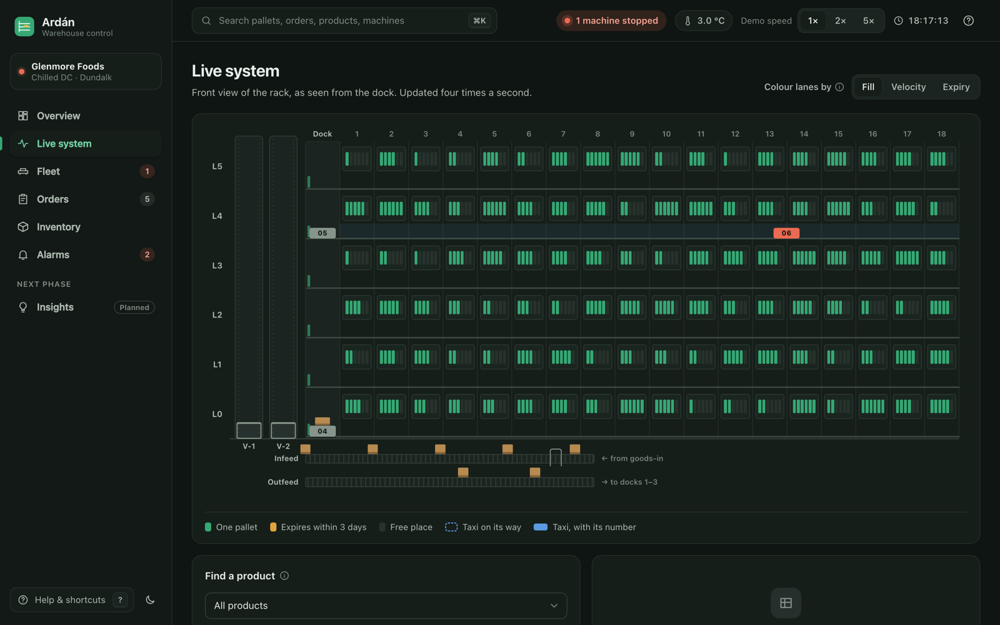
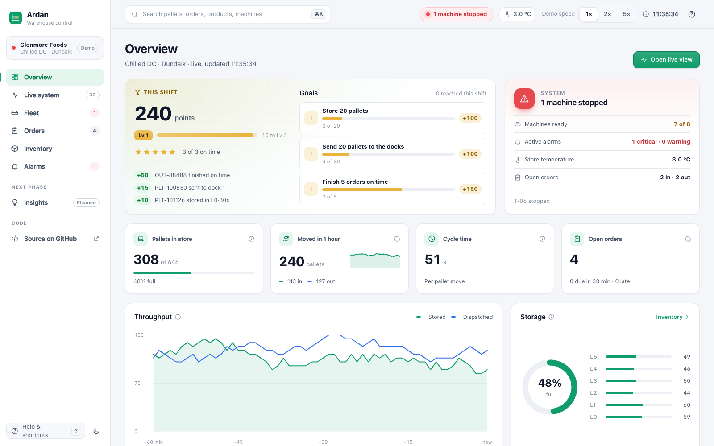
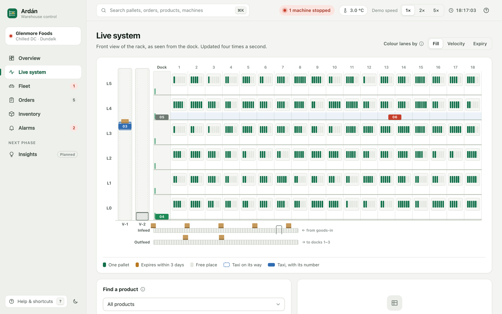
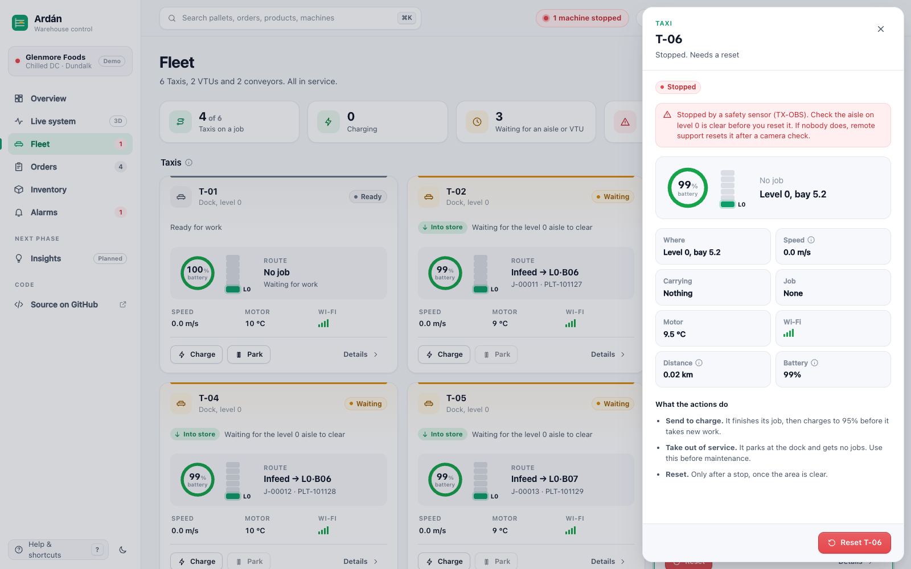
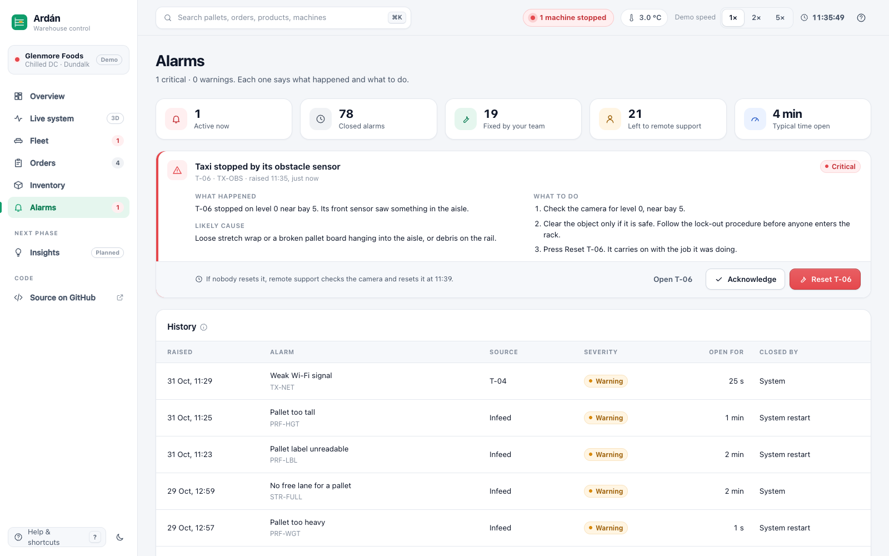
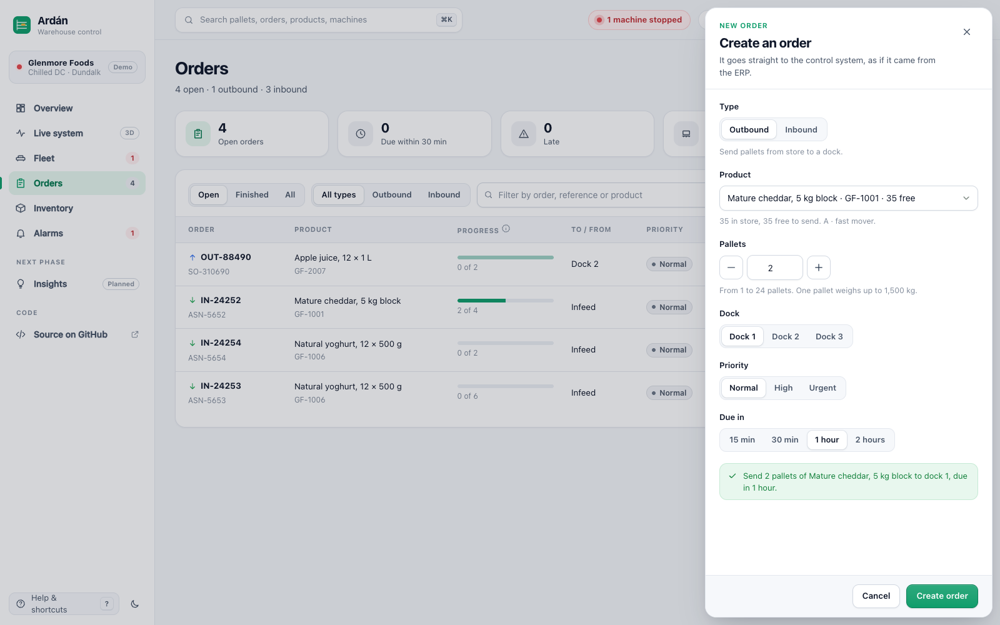
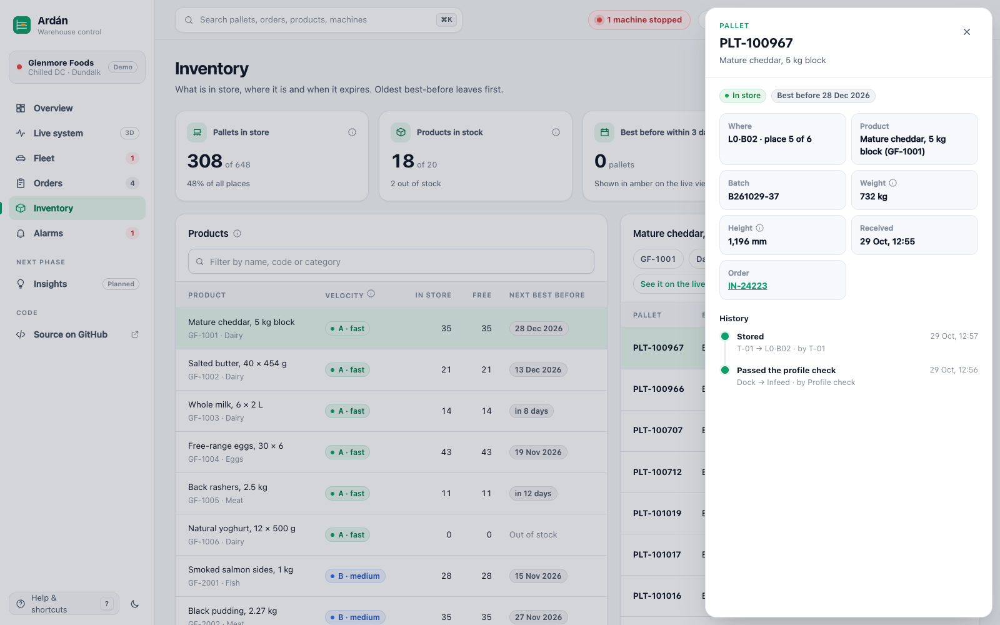

# Ardán

A warehouse control system (WCS) concept for an automated pallet store, built end to end in .NET:
a live simulation of the store, an HTTP and SignalR API, and an operator console in Blazor.

The demo site is fictional: Glenmore Foods, a chilled distribution centre in Dundalk. Machine figures
(speeds, loads, temperatures) follow public data sheets for pallet-shuttle systems. Not affiliated with any vendor.



## What the console does

| Screen | What you can do |
| --- | --- |
| Overview | KPIs, throughput for the last hour, storage per level, the whole fleet at a glance, alarms that need attention, live activity. |
| Live system | A front view of the rack (6 levels, 18 bays, lanes 6 pallets deep). Taxis move on their rails, two VTUs carry them between levels, pallets travel on the infeed and outfeed. Colour lanes by fill, velocity or expiry, find a product, click a lane or a Taxi. |
| Fleet | Every Taxi, VTU and conveyor. Send to charge, take out of service, reset after a stop. Each command asks for confirmation and says what will happen. |
| Orders | ERP orders plus your own. Filter, change priority, cancel, and create inbound or outbound orders with a live free-stock check. |
| Inventory | Products, their pallets in best-before order, and each pallet's history from the infeed onwards. |
| Alarms | What happened, the likely cause and the steps to fix it, with the right action button. Closed alarms show who fixed them. |
| Insights | The plan for AI-assisted features in the next phase. |

Every number and state has an explanation on hover. `?` opens help for the page and `⌘K` searches pallets, orders, products and machines.
Light and dark themes follow the system setting and can be switched in the sidebar.

## Screenshots

| Overview | Live system, light theme |
| --- | --- |
|  |  |
| **Fleet** | **Alarms** |
|  |  |
| **New order** | **Inventory** |
|  |  |

## Run it

Needs the [.NET 10 SDK](https://dotnet.microsoft.com/download).

```bash
./run.sh
```

Open http://localhost:5090. The API listens on http://localhost:5080 and serves its OpenAPI document at `/openapi/v1.json`.

To run the parts yourself:

```bash
dotnet run --project src/Ardan.Api
dotnet run --project src/Ardan.Web
```

With Docker, the way the live demo runs:

```bash
docker build -t ardan .
docker run --rm -p 8080:8080 ardan
```

The container runs the tests while it builds, then starts the API on `127.0.0.1:5080` inside the container
and serves the console on port 8080.

Tests:

```bash
dotnet test
```

The store keeps its state in `src/Ardan.Api/App_Data/ardan.db`. Delete that file to start again from the demo stock.

## Rules the simulation follows

- Deep lanes are last in, first out. A lane holds one batch, so it never mixes best-before dates.
- Retrieval takes the earliest best-before first (FEFO), then the nearest lane.
- Velocity slotting: fast movers (A) are stored near the VTUs, slow movers (C) at the back.
- One Taxi per aisle per level. Taxis change level only on a VTU.
- The infeed checks every pallet: height up to 1,800 mm, weight up to 1,500 kg, a readable label. Failures go to the reject lane.
- Taxis take jobs above 30% battery and charge at the dock whenever they stop there.
- A stopped machine that nobody resets within 4 minutes is reset by remote support.
  A rejected pallet that is not fixed within 10 minutes goes back to the supplier.

## Project layout

| Folder | Contents |
| --- | --- |
| `src/Ardan.Core` | Domain model and simulation. No web or database dependencies. |
| `src/Ardan.Api` | ASP.NET Core minimal API, SignalR hub, EF Core journal on SQLite. |
| `src/Ardan.Web` | Blazor Web App (interactive server): the operator console. |
| `tests/Ardan.Core.Tests` | xUnit tests for storage rules, order flow and long simulation runs. |
| `docs` | [Architecture](docs/architecture.md) and the [AI feature plan](docs/ai-features.md). |
